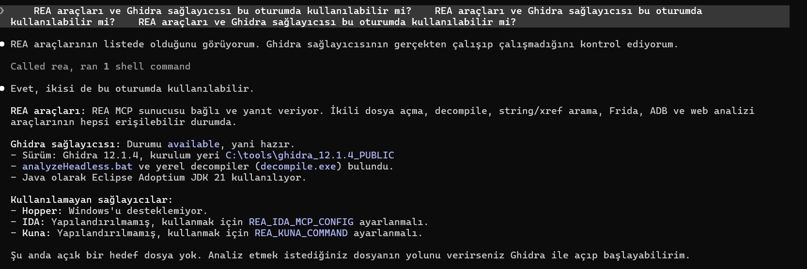

# pairedpower — Eşleştirilmiş örneklem t testi için güç analizi CLI'si (YZM301 · Teardown Sprint · K2)

> **Yapılan katmanlar:** ✅ Temel katman (CLI) · ✅ MCP sunucusu (+15) · ✅ AI ajanı (+10)
>
> Hesap mantığı tek motordadır (`src/pairedpower/engine.py`). CLI, MCP sunucusu ve ajan bu motoru çağıran ince katmanlardır.

**Hazırlayan:** Elif Hazar — bireysel çalışma 
**Test ailesi:** K2 — t testi, eşleştirilmiş ortalamalar (önce/sonra tansiyon). G*Power karşılığı: *t tests → Means: Difference between two dependent means (matched pairs)*.

Bu proje G*Power'ın yerine geçmez ve G*Power adını taşımaz. G*Power'ın matched-pairs t testi davranışı tersine mühendislik ve arayüz gözlemiyle belgelendi, ardından temiz oda yöntemiyle yeniden yazıldı. CLI komutunun adı (`gpower-clone`) ödev sözleşmesinden gelir.

---

## Sonuçlar (özet)

| Ölçüt | Sonuç | Kaynak |
|---|---|---|
| G*Power arayüz vektörleri | 38 (30 hesaplı + 8 hata), hepsi ekran görüntülü | `oracle/gpower_vectors.csv`, `oracle/screenshots/` |
| **N ve df tam eşleşme** | **30/30** | `tests/test_differential.py` |
| Güç, kritik t, δ (G*Power'ın 7 ondalığı) | 90/90 | aynı |
| Hata vektörleri (G*Power hata verdi → biz de hata) | 8/8 | aynı |
| G*Power kılavuz örnekleri (§19.3, matched pairs) | 2/2 (kılavuzun 6 ondalığı) | `oracle/manual_vectors.csv`, `tests/test_manual.py` |
| Kütüphane vektörleri (statsmodels) | 1000 vektör; farkların hepsi açıklandı | `oracle/library_vectors.csv`, `tests/UYUM_RAPORU.md` |
| CLI = MCP eşitliği (gerçek MCP protokolü) | 98/98 girdi birebir aynı JSON (38 G*Power + 60 kütüphane) | `tests/test_mcp_parity.py` |
| Ajan değerlendirmesi (10 Türkçe soru) | haiku ve opus ile ayrı ayrı: etiket 10/10, parametre 7/7, N/güç = G*Power 7/7 | `agent/EVAL_RAPORU.md`, `agent/EVAL_RAPORU_opus.md` |
| Token karşılaştırması (aynı model opus, aynı birim: bağlama eklenen token, Q01–Q09) | MCP 9,124 · GUI 19,660 (GUI 2.2 kat; kurulum hariç 1.5 kat); model çağrısı 16 / 31; süre 187 / 254 sn | `agent/TOKEN_KARSILASTIRMA.md` |
| Toplam test | 1190 geçti (1089 + 99 MCP eşitlik testi + 2 kılavuz örneği) | `pytest -q` |
| [REA] bulguları | 16 adresli REA bulgusu; 14'ü GUI vektörleriyle çapraz doğrulandı, her satırın doğrulama durumu `LEDGER.md` [REA] tablosunda | `LEDGER.md`, `rea_notes/REA_BULGULAR.md` |
| Kanıtlanmış ajan hataları | 7 madde | `HALLUCINATIONS.md` |

## Kurulum

Python 3.10+ gerekir (geliştirme ve test Python 3.14, scipy 1.18.1 ile yapıldı).

```
python -m venv .venv
.venv\Scripts\activate          (macOS/Linux: source .venv/bin/activate)
pip install -e ".[dev]"
```

## Çalıştırma

```
gpower-clone --test t-paired --mode a-priori --tails 2 --dz 0.5 --alpha 0.05 --power 0.80
{"n_total":34,"actual_power":0.8078,"critical":2.0345,"df":33,"ncp":2.9155}

gpower-clone --test t-paired --mode post-hoc --tails 2 --dz 0.5 --alpha 0.05 --n 35
{"n_total":35,"actual_power":0.8195,"critical":2.0322,"df":34,"ncp":2.958}

gpower-clone --test t-paired --mode a-priori --tails 2 --dz 0.5 --alpha 0.05 --power 0.04
{"error": "Power must be greater than or equal to alpha."}      (çıkış kodu 2)
```

| Bayrak | Anlam |
|---|---|
| `--test t-paired` | test ailesi |
| `--mode a-priori` / `post-hoc` | N hesapla / gücü hesapla |
| `--tails 1` / `2` | tek / iki kuyruk |
| `--dz` (eş ad `--d`) | etki büyüklüğü dz = ortalama fark / farkların SD'si |
| `--alpha` | I. tip hata |
| `--power` | hedef güç (a-priori) |
| `--n` (eş adlar `--n-total`, `--n_total`) | çift sayısı (post-hoc) |

Ödevde t-paired için ayrı bir CONTRACT.md bulunmadığından bayrak ve alan adları t2-indep örneğinden türetildi; iki olası adlandırma da kabul edilir (`SPEC.md` §3, `HALLUCINATIONS.md` H-01).

## MCP sunucusu

`src/pairedpower/mcp_server.py` — resmi Python `mcp` paketi (FastMCP, `mcp>=1.2,<2`; test edilen sürüm 1.30.0) ile stdio sunucusu.
Araç yalnızca `engine.calculate(...)` fonksiyonunu çağırır. Doğrulama, mod seçimi, zorunlu alan kontrolü ve 4 ondalık yuvarlama
CLI ile **aynı kod yolundan** gelir (`engine.solve` + `engine.to_dict`); MCP katmanında formül yoktur.

Kurulum ve çalıştırma (`pip install -e ".[dev]"` sonrası):

```
pairedpower-mcp                      (stdio sunucusu; bir MCP istemcisi başlatır)
python -m pairedpower.mcp_server     (aynısı)
```

Claude Code'a kayıt (proje klasöründe, sanal ortam etkinken):

```
claude mcp add pairedpower -- pairedpower-mcp
```

Sanal ortam etkin değilse tam yol verin: `claude mcp add pairedpower -- "<repo>\.venv\Scripts\pairedpower-mcp.exe"`.
Claude Code'da araç adı `mcp__pairedpower__t_paired_power` olur.

### Araç şeması: `t_paired_power`

Girdi:

| Alan | Tip | Zorunlu | Anlam | CLI karşılığı |
|---|---|---|---|---|
| `mode` | string: `"a-priori"` / `"post-hoc"` | evet | N hesapla / gücü hesapla | `--mode` |
| `tails` | number: `1` / `2` | evet | tek / iki kuyruk | `--tails` |
| `dz` | number, −20…20 | evet | etki büyüklüğü dz = ortalama fark / farkların SD'si | `--dz` (`--d`) |
| `alpha` | number, 1e-07…0.9999999 | evet | I. tip hata | `--alpha` |
| `power` | number ya da null, 1e-07…0.9999999 | a-priori'de evet | hedef güç | `--power` |
| `n` | number ya da null | post-hoc'ta evet | çift (denek) sayısı; en yakın tamsayıya yuvarlanır | `--n` (`--n-total`, `--n_total`) |

Moda ait olmayan alan (a-priori'de `n`, post-hoc'ta `power`) yok sayılır. `mode` ve `tails` şemada bilerek geniş tiplidir
(string / number): geçersiz değer şema katmanında değil, CLI ile aynı motor doğrulamasında yakalanır ve aynı `{"error": ...}` döner.

Çıktı (araç sonucu tek bir JSON metni; alanlar ve değerler CLI çıktısıyla birebir aynı):

| Alan | Tip | Ne zaman | Anlam |
|---|---|---|---|
| `n_total` | integer | başarı | a-priori: bulunan N; post-hoc: yuvarlanmış N |
| `actual_power` | number (4 ondalık) | başarı | güç(N) |
| `critical` | number (4 ondalık) | başarı | kritik t (dz < 0 ise negatif) |
| `df` | integer | başarı | N − 1 |
| `ncp` | number (4 ondalık) | başarı | δ = dz·√N |
| `error` | string | hata | hata açıklaması (bu durumda başka alan yok) |

Örnek: `{"mode":"a-priori","tails":2,"dz":0.5,"alpha":0.05,"power":0.8}` → `{"n_total":34,"actual_power":0.8078,"critical":2.0345,"df":33,"ncp":2.9155}`.

**CLI = MCP testi:** `tests/test_mcp_parity.py`, `oracle/gpower_vectors.csv`'deki 38 satırın (30 hesaplı + 8 hata) her birini ve
`oracle/library_vectors.csv`'den eşit aralıklı 60 satırı (30 a-priori + 30 post-hoc) iki yoldan çalıştırır: CLI alt süreç olarak,
MCP aracı ise resmi `mcp` stdio istemcisiyle **gerçek MCP protokolü üzerinden**. 98/98 girdide iki JSON birebir aynı
(anahtarlar, değerler ve int/float tipleri). Sonuç: `tests/UYUM_RAPORU.md` §5.

## AI ajanı

`agent/agent.py` — hekimin Türkçe sorusunu MCP aracıyla yanıtlayan ajan. LLM: Claude Code başsız modda (`claude -p`).
Yalnızca bizim MCP sunucumuz yüklenir (`--mcp-config` + `--strict-mcp-config`), yalnızca `mcp__pairedpower__t_paired_power`
aracına izin verilir (`--allowedTools`), yerleşik araçlar kapalıdır (`--tools ""`). Türkçe sistem prompt'u: `agent/system_prompt.md`
(önce test ailesi etiketi → parametreler → araç çağrısı → sade Türkçe cevap; sayı asla ajan tarafından üretilmez; etiket
`t-paired` değilse ya da güven düşükse araç çağrılmaz; `ambiguous` ise araştırmacıya soru sorulur).

**Test ailesi seçimi (ödevdeki isteğe bağlı Jev maddesi):** Jev kullanılmadı. Ödevin önerdiği yedek yol izlendi: test ailesini, ödevdeki etiket setine (`t2-indep`, `t-paired`, `anova-oneway`, `chi2-contingency`, `multireg-r2`, `ambiguous`, `unsupported`) kısıtlanmış bir LLM (Claude) seçiyor. Güven sayısal değil, üç düzeyli (yüksek/orta/düşük); düşükse karar araştırmacıya bırakılıyor. İsteğe bağlı kalibrasyon ölçümü ve İngilizce karşılaştırması yapılmadı. Etiket hiçbir sayı üretmez; N ve güç her zaman motordan gelir.

```
python agent/agent.py "Aynı hastalarda önce/sonra tansiyon ölçeceğim; dz=0,5, alfa 0,05, iki yönlü, %80 güç. Kaç hasta?"
python agent/run_eval.py             (10 soruluk seti çalıştırır, agent/EVAL_RAPORU.md üretir)
python agent/run_eval.py --reuse     (var olan loglardan yalnızca raporu üretir)
```

Varsayılan model `claude-haiku-5-5` (`--model` ile değişir). Her sorunun tam akışı — araç çağrısı argümanları, araç sonucu,
son cevap, `stream-json` çıktısındaki ölçülmüş token kullanımı, maliyet ve süre — `agent/logs/<id>.json` dosyasına yazılır.

### Değerlendirme sonucu (`agent/EVAL_RAPORU.md`)

Set: `agent/eval_set.csv` — 10 kurgusal Türkçe soru: 7 t-paired (a-priori ve post-hoc, tek ve iki kuyruk, ortalama/SD'den dz
dönüşümü, sınır durumu dz = 0.01 → N = 78491), 2 başka aile (t2-indep, chi2-contingency), 1 belirsiz. Beklenen N/güç
değerleri `oracle/gpower_vectors.csv`'deki G*Power değerleridir.

| Ölçüt | Sonuç |
|---|---|
| Etiket (doğru test ailesi seçimi) | **10/10** |
| Karar (t-paired → aracı çağır; diğerleri → çağırma) | **10/10** |
| Parametreler (mod, kuyruk, dz, α, güç/N) | **7/7** |
| N/güç = G*Power (4 ondalık) | **7/7** |
| Toplam token / maliyet / süre | haiku: 73,201 token · $0.0069 · 174.6 sn; opus: 73,538 token · $0.2700 · 204.9 sn |

Set iki modelle ayrı ayrı çalıştırıldı (haiku: `agent/logs/`, `agent/EVAL_RAPORU.md`; opus: `agent/logs_opus/`,
`agent/EVAL_RAPORU_opus.md`); ikisinde de sonuçlar aynı. Opus çalıştırması GUI yoluyla aynı modelle karşılaştırma içindir.

### Token karşılaştırması (`agent/TOKEN_KARSILASTIRMA.md`)

Aynı 10 soru G*Power arayüzünde, bilgisayar kullanımı aracıyla ekran görüntüsü okunarak da çözüldü (öğrencinin onayıyla).
İki yol **aynı modelle (claude-opus-5-5)** ve **aynı birimle** karşılaştırıldı. Tablo `python agent/token_compare.py` ile
loglardan ve `agent/gui_measurements.csv`'den üretilir.

| Q01–Q09 (GUI'nin uygulanabildiği 9 soru) | MCP yolu | GUI yolu |
|---|---|---|
| Bağlama eklenen token (ölçüldü) | **9,124** | **19,660** (ölçüm yükü çıkarılmış; ham 26,275) |
| Aynısı, Q01 kurulumu hariç (Q02–Q09) | 7,860 | 11,719 |
| Model çağrısı | 16 | 31 |
| Süre | 187 sn | 254 sn |
| Doğruluk | 9/9 (Q10 dahil 10/10) | 9/9 (Q10 uygulanamaz) |
| Soruyu anlama adımı | dahil | **dahil değil** (parametreler hazır verildi) |

Sonuç: aynı model ve birimle GUI yolu MCP yolundan **2.2 kat** (kurulum hariç 1.5 kat) daha fazla bağlam token'ı ve yaklaşık iki kat
model çağrısı kullandı. GUI soruyu anlama adımını içermediği için bu bir alt sınırdır.

Hesap: MCP için soru başına bağlama eklenen = son model çağrısının girdisi + çıktısı − sabit önek (sistem prompt'u + araç şeması,
yalnızca "." gönderilen kalibrasyon çağrısıyla ölçüldü: 3,623 token). GUI için her sorudan önce ve sonra okunan oturum bağlamı farkı,
eksi ölçüm adımının kendi yükü (735 token, ardışık iki ölçümden).

Faturalanan token: MCP yolunda ölçüldü (opus 73,538 token · $0.27; haiku 73,201 token · $0.0069). GUI yolunda **ölçülmedi**.
Ölçülen bağlam boyutları × model çağrısı sayısından hesaplanan aralık 5.5–5.7 milyon girdi token'ıdır. Bu bir ölçüm değildir ve
bu oturumun büyük taban bağlamına (~167k) bağlıdır. GUI yolunda bir giriş hatası (alan metni seçilmeden yazıldı) ancak ekran
görüntüsü okununca yakalandı.

## Testler

```
pytest -q
```
- `tests/test_spec.py` — SPEC §7 Gherkin senaryoları ve §3.1 kararları
- `tests/test_differential.py` — G*Power arayüz vektörlerine karşı diferansiyel test
- `tests/test_library.py`, `tests/gen_library_vectors.py` — statsmodels ile 1000 vektör
- `tests/test_mcp_parity.py` — CLI = MCP eşitliği (gerçek MCP protokolü, 98 girdi)
- `tests/UYUM_RAPORU.md` — uyum oranları ve her uyuşmazlığın açıklaması
- `tools/library_check.py` — inceleme oturumunda kullanılan bağımsız scipy çapraz kontrolü (uygulama kodu değildir)

## Sürüm bilgisi

| Bileşen | Sürüm / değer |
|---|---|
| İncelenen program | G*Power 3.1.9.7 (Windows), resmi sayfadan (psychologie.hhu.de) |
| Program dosyası | `GPowerNT.exe` (ödev metninde `GPower.exe` olarak geçiyor; resmi paketteki adı budur) |
| **SHA-256** | **`C63E6A133EB6372932F810C08CC33DC35A06D1DDB658F897BD6C34A754EFC812`** (`oracle/screenshots/S00_hash.png`) |
| Ghidra | 12.1.4 PUBLIC (zip SHA-256 GitHub sürüm sayfasıyla karşılaştırıldı) |
| REA | rea-agents 6.7.0 (npm), Ghidra sağlayıcısı |
| JDK | Temurin 21.0.12.1 |
| Ajanlar | Claude (claude.ai, inceleme ve şartname), Claude Code 2.1.303 (REA analizi ve temiz oda yazımı) |
| Python / scipy | 3.14 / 1.18.1 |
| mcp (Python SDK) | 1.30.0 (FastMCP) |
| Ajan LLM'i | Claude Code 2.1.309 başsız mod (`claude -p`); claude-haiku-5-5 (varsayılan) ve claude-opus-5-5 (GUI ile aynı model karşılaştırması) |

G*Power programı bu depoda **yoktur** ve dağıtılmaz (`.gitignore`).

## REA / Ghidra kontrolü

Ajan: *"REA araçları ve Ghidra sağlayıcısı bu oturumda kullanılabilir mi?"* → Claude Code: evet; Ghidra 12.1.4 kullanılabilir, analyzeHeadless ve yerel decompiler bulundu.



Not: claude.ai bulut sohbetlerinde REA kullanılamadı; yerel Claude Code gerekti (`HALLUCINATIONS.md` H-10).

## Süreç ve temiz oda

1. **İnceleme (Oturum 1):** belgeler okundu; G*Power arayüzünden 38 vektör ekran görüntüsüyle toplandı; REA + Ghidra ile hesap motoru incelendi (`prompts/oturum1_inceleme.md`, `prompts/oturum1_rea_gorevi.md`). Çıktılar: `LEDGER.md`, `SPEC.md`, `HALLUCINATIONS.md`, `oracle/`, `rea_notes/`.
2. **Yazım (Oturum 2):** ayrı bir klasörde (`C:\paired-power`), yeni bir Claude Code oturumu yalnızca `SPEC.md` ile başladı (`prompts/oturum2_yazim.md`). G*Power vektörleri (yalnızca girdi/çıktı değerleri) kod ve SPEC testleri bittikten sonra diferansiyel test için verildi (`prompts/oturum2_diferansiyel.md`). Yazım oturumu LEDGER'ı, REA notlarını ve decompile çıktısını görmedi.
3. **Bonus katmanlar (Oturum 3):** yeni bir Claude Code oturumu (`prompts/oturum3_mcp_ajan.md`) yalnızca SPEC, README'ler, `src/`, `tests/` ve oracle CSV'leriyle çalıştı; LEDGER, HALLUCINATIONS, `rea_notes/` ve Oturum 1 prompt'larını açmadı. MCP sunucusu, CLI = MCP testleri, ajan, değerlendirme ve GUI karşılaştırması bu oturumda yapıldı.
4. **Son kontrol (Oturum 1'in devamı, 2026-10-26):** inceleme oturumu belgelerdeki tutarsızlıkları düzeltti ve G*Power kılavuzunun matched-pairs örneklerini kâhine ekledi (`oracle/manual_vectors.csv`, `tests/test_manual.py`). Bu oturum `src/` altındaki koda dokunmadı; eklenen test yalnızca kılavuzda yayımlanmış girdi/çıktı değerlerini CLI ile karşılaştırır.
5. Teslim edilen kodda decompile çıktısı yoktur. `rea_notes/REA_BULGULAR.md` yalnızca fonksiyon/dize adresleri ve kısa alıntılar içerir (ödevin izin verdiği biçimde).

## Belgeler

| Dosya | İçerik |
|---|---|
| `SPEC.md` | Kabul kriterleri Gherkin formatında; her kural kanıt etiketiyle |
| `LEDGER.md` | Kanıt defteri: [DOK], [REA], [AJAN] ve GUI gözlemleri |
| `HALLUCINATIONS.md` | Ajanın yanlış çıkardıkları, nasıl fark edildiği, hangi testin yakaladığı |
| `AGENT_COST.md` | Ajanlar, ölçülmüş maliyet, iterasyonlar, neyi farklı yapardık |
| `prompts/` | İki oturumun ilk prompt'ları ve sonraki görev prompt'ları |
| `oracle/` | G*Power vektörleri, kütüphane vektörleri, ekran görüntüleri |
| `agent/` | Ajan, sistem prompt'u, değerlendirme seti ve raporu, token karşılaştırması, loglar, GUI ekran görüntüleri |

## Demo

CLI demo videosu (36 saniye; ödevdeki 60 saniye sınırının altında): https://drive.google.com/file/d/132n-g22Ssp__Az5gds-arHfjYCCOhaw2/view?usp=sharing

Videoda: a-priori (N=34), post-hoc (güç 0.8195), geçersiz girdi (`error`) ve G*Power diferansiyel testi (38 passed).

## Atıf

G*Power'ın yazarlarına bu aracı bilim dünyasına ücretsiz sundukları için teşekkür ederiz:

- Faul, F., Erdfelder, E., Lang, A.-G., & Buchner, A. (2007). G*Power 3: A flexible statistical power analysis program for the social, behavioral, and biomedical sciences. *Behavior Research Methods, 39*, 175–191.
- Faul, F., Erdfelder, E., Buchner, A., & Lang, A.-G. (2009). Statistical power analyses using G*Power 3.1: Tests for correlation and regression analyses. *Behavior Research Methods, 41*, 1149–1160.

Bu çalışma YZM301 dersi kapsamında eğitim amacıyla yapılmıştır.
